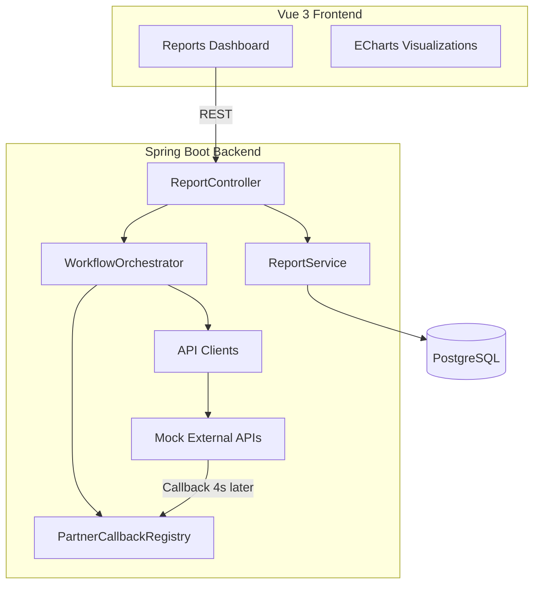
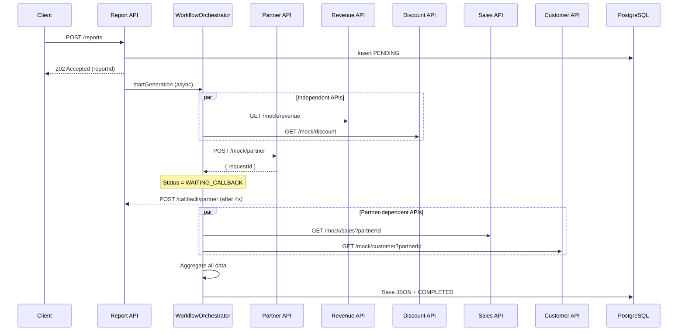

# Sales Report Generation System

A production-style full-stack application that generates sales reports asynchronously by orchestrating multiple external APIs, including a partner service that responds via webhook callback.

## Architecture Overview



## Workflow Diagram



## Tech Stack

| Layer    | Technologies |
|----------|-------------|
| Backend  | Java 21, Spring Boot 3.3, Spring Data JPA, PostgreSQL, Lombok, MapStruct, CompletableFuture |
| Frontend | Vue 3, Vite, Pinia, Vue Router, Axios, TailwindCSS, Apache ECharts |
| Infra    | Docker, Docker Compose |

## Folder Structure

```
.
├── backend/
│   └── src/main/java/com/salesreport/
│       ├── callback/          # Partner callback registry & handler
│       ├── client/            # HTTP clients for external APIs
│       ├── config/            # Async, Web, Jackson configuration
│       ├── controller/        # REST endpoints (thin layer)
│       │   └── mock/          # Simulated external APIs
│       ├── dto/               # Request/response data transfer objects
│       ├── entity/            # JPA entities
│       ├── exception/         # Global exception handling
│       ├── mapper/            # MapStruct entity ↔ DTO mappers
│       ├── repository/        # Spring Data JPA repositories
│       ├── service/           # Application services
│       ├── util/              # Aggregation, mock data, JSON helpers
│       └── workflow/          # WorkflowOrchestrator
├── frontend/
│   └── src/
│       ├── api/               # Axios API layer
│       ├── components/        # Reusable UI + chart components
│       ├── router/            # Vue Router
│       ├── stores/            # Pinia state management
│       └── views/             # Page-level components
├── docker-compose.yml
└── README.md
```

## Prerequisites

- **Local development:** Java 21, Maven 3.9+, Node.js 20+, PostgreSQL 16+
- **Docker:** Docker Desktop or Docker Engine with Compose v2

## Setup Instructions

### Option 1: Docker Compose (recommended)

```bash
docker compose up --build
```

| Service  | URL |
|----------|-----|
| Frontend | http://localhost:5173 |
| Backend  | http://localhost:8080 |
| Postgres | localhost:5432 |

### Option 2: Local Development

#### 1. Start PostgreSQL

```bash
docker run -d --name sales-report-db \
  -e POSTGRES_DB=sales_report \
  -e POSTGRES_USER=sales_user \
  -e POSTGRES_PASSWORD=sales_pass \
  -p 5432:5432 postgres:16-alpine
```

#### 2. Run Backend

```bash
cd backend
mvn spring-boot:run
```

Backend starts on **http://localhost:8080**.

#### 3. Run Frontend

```bash
cd frontend
npm install
npm run dev
```

Frontend starts on **http://localhost:5173** with API proxy to the backend.

## API Endpoints

| Method | Endpoint | Description |
|--------|----------|-------------|
| POST   | `/reports` | Create report and start async generation |
| GET    | `/reports` | List all reports |
| GET    | `/reports/{id}` | Get report details |
| POST   | `/callback/partner` | Partner webhook callback |

### Mock External APIs

| Method | Endpoint | Description |
|--------|----------|-------------|
| POST   | `/mock/partner` | Initiate partner lookup (callbacks after 4s) |
| GET    | `/mock/sales?partnerId=` | Sales data by partner |
| GET    | `/mock/customer?partnerId=` | Customer data by partner |
| GET    | `/mock/revenue` | Independent revenue data |
| GET    | `/mock/discount` | Independent discount data |

## Report Status Lifecycle

```
PENDING → PROCESSING → WAITING_CALLBACK → COLLECTING_DATA → COMPLETED
                                                          ↘ FAILED
```

## Assumptions

1. **Single instance deployment** — the in-memory `PartnerCallbackRegistry` is sufficient for this assignment; a multi-instance deployment would require Redis or a message broker.
2. **Mock APIs are co-located** — external APIs run in the same Spring Boot application but are accessed via HTTP to simulate real network boundaries.
3. **Partner callback delay** is configurable via `app.partner.callback-delay-ms` (default 4000ms).
4. **JSONB storage** — individual API payloads and aggregated data are stored as PostgreSQL JSONB columns for flexibility.
5. **No authentication** — omitted for scope; production would add OAuth2/JWT.

## Design Decisions

| Decision | Rationale |
|----------|-----------|
| Clean Architecture package layout | Separates HTTP, workflow, persistence, and integration concerns |
| `WorkflowOrchestrator` as single coordinator | One place owns the full async lifecycle; controllers stay thin |
| `CompletableFuture` + `@Async` | Maximizes parallelism for independent APIs while chaining dependent calls |
| HTTP clients for mock APIs | Preserves realistic integration patterns even for in-process mocks |
| MapStruct + DTOs | Type-safe mapping between entities and API contracts |
| JSONB columns | Schema-flexible storage for heterogeneous API responses |
| Pinia store + 3s polling | Simple, reliable UI updates without WebSocket complexity |

## Future Improvements

- Replace in-memory callback registry with Redis or Kafka for horizontal scaling
- Add WebSocket/SSE for real-time status push instead of polling
- Implement retry with exponential backoff for failed API calls
- Add Spring Retry and circuit breaker (Resilience4j) for external API resilience
- Introduce OAuth2 authentication and role-based access control
- Add integration tests with Testcontainers
- Extract mock APIs into a separate service for true microservice simulation
- Add report export (PDF/Excel) and scheduled report generation

## License

MIT
